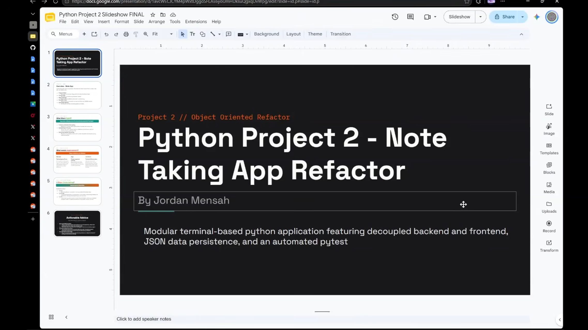

# ^ Click Thumbnail To Watch Video ^
# Project 2 - Note Taking App OOP Refactor

**Author**: Jordan Mensah
**Date**: 11/1/26

**Description**

A terminal-based python application for taking notes. Refactored according to object-oriented principles for project 2.

**Features**

* Create, Edit, View, and Delete Notes
* Persistent JSON Data Storage
* Frontend/Backend Seperation
* Automated Unit Testing Suite

**Included Files**

* `main.py` : Frontend 
* `notebook.py` : Backend
* `note.py` : Backend Note Class/Text Analysis
* `test_notebook.py` : Automated Testing Suite
* `requirements.txt` : Dependancies
* `.gitignore` : Version Control Exclusions

**Testing**
To execute the automated test suite, run the follow command:
`pytest test_notebook.py`

**Acknowledgements**

* [Project Guidelines](https://courses.cscc.edu/ultra/courses/_238744_1/assessment/_28741563_1/attempt/_66804670_1?courseId=_238744_1)
* [Python Online Textbook](https://learning.oreilly.com/library/view/python-crash-course/9781098156664/)
* [Pathlib Python Module Help](https://www.geeksforgeeks.org/python/pathlib-module-in-python/)
* [Python JSON read/write help](https://www.geeksforgeeks.org/python/reading-and-writing-json-to-a-file-in-python/)
* [Python Dictionary help](https://www.geeksforgeeks.org/python/python-dictionary/)
* [Project Slideshow](https://docs.google.com/presentation/d/1avcWECJCYM4pWxtDggoSFLAE6yoUmHDksuQgxqDvWpg/edit?usp=sharing)
* [Dictionary Dispatch Guide](https://martinheinz.dev/blog/90)
* [Python If Not Guide](https://pythonguides.com/if-not-condition-in-python/)
* [Pytest Testing/Fixtures Help](https://www.geeksforgeeks.org/python/pytest-tutorial-testing-python-application-using-pytest/)
* [Pytest Help 2](https://learning.oreilly.com/library/view/python-crash-course/9781098156664/c11.xhtml#h1-502703c11-0001)
* [Pytest Help 3](https://www.geeksforgeeks.org/python/getting-started-with-pytest/)
* [Direct Video Link](https://www.youtube.com/watch?v=sEFfVBCzTL4)
